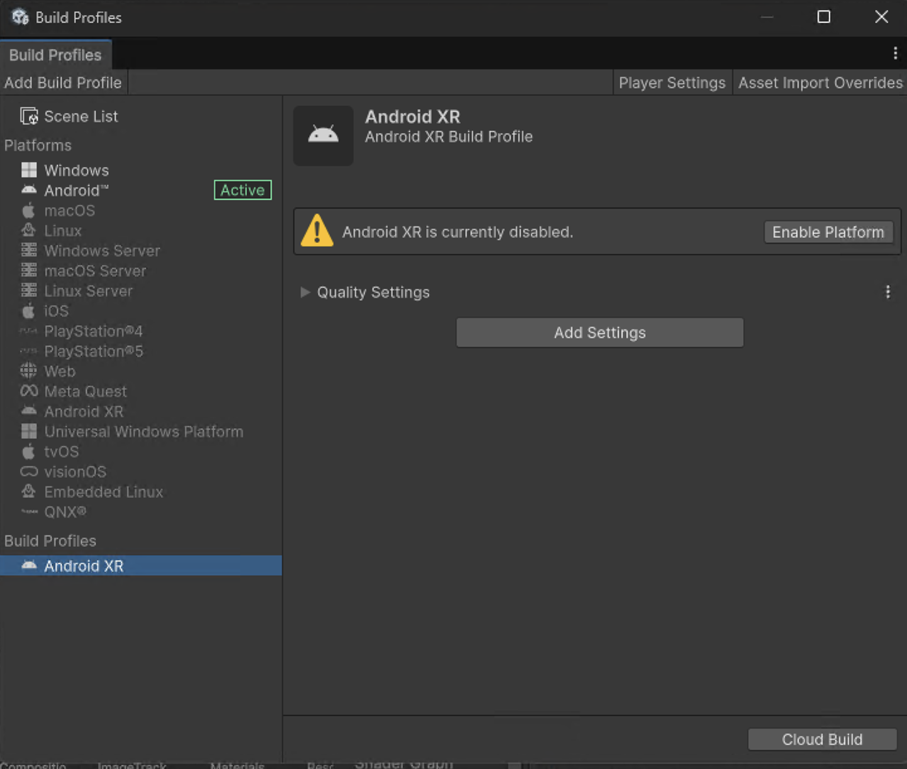

# XREAL AURA 向け Android XR スターターキット

[English](./README.md)

| Scene 0〜2 | Scene 3〜5 |
| --- | --- |
| [](https://youtu.be/52wZrd1oV24) | [](https://youtu.be/FxXNzq-5ClU) |
| ▶ [デモ動画を YouTube で見る](https://youtu.be/52wZrd1oV24) | ▶ [デモ動画を YouTube で見る](https://youtu.be/FxXNzq-5ClU) |

XREAL AURA 向けの Android XR アプリ開発を始めるための Unity プロジェクトです。7 つのサンプルシーンで、3D オブジェクトの表示、ハンドトラッキングによる操作、空間 UI の実装、カメラ画像へのアクセス、実物による仮想オブジェクトの遮蔽（オクルージョン）、画像マーカーの認識と追跡、Geospatial API による緯度・経度を指定したオブジェクトの配置を試せます。OpenXR、XR Interaction Toolkit、Universal Render Pipeline（URP）を使用しています。

## サンプルシーン

`OpenXR-Sample` を Unity で開き、`Assets/Scenes` から各シーンを選びます。

| シーン | 試せること |
| --- | --- |
| [`0-ShowObject`](./OpenXR-Sample/Assets/Scenes/0-ShowObject.unity) | 周囲の空間に仮想のキューブを表示します。まずこのシーンで、グラスに 3D オブジェクトが表示されることを確認できます。 |
| [`1-ObjectManipulation`](./OpenXR-Sample/Assets/Scenes/1-ObjectManipulation.unity) | 片手でキューブをつかんで移動・回転できます。両手でつかんで手の間隔を変えると、位置と向きを保ったまま拡大・縮小できます。 |
| [`2-UI`](./OpenXR-Sample/Assets/Scenes/2-UI.unity) | ワールド空間の Canvas にあるボタンでキューブの表示・非表示を切り替えます。入力欄を選んで空間キーボードで文字を入力すると、キューブの上のラベルに反映されます。 |
| [`3-CameraImage`](./OpenXR-Sample/Assets/Scenes/3-CameraImage.unity) | カメラの権限を許可すると、デバイスのカメラ映像が周囲の空間のパネルに表示されます。利用できるカメラの一覧と画像サイズも、ラベルに表示します。 |
| [`4-Occlusion`](./OpenXR-Sample/Assets/Scenes/4-Occlusion.unity) | 壁のような実物は、その後ろにあるキューブを隠します。`1-ObjectManipulation` と同じ操作でキューブを壁にめり込ませると、壁の中に入った部分が隠れます。Android XR がオクルージョンに必要とする権限は、求められたときに許可してください。 |
| [`5-ImageTracking`](./OpenXR-Sample/Assets/Scenes/5-ImageTracking.unity) | 画面などに表示したマーカー画像（`Assets/ImageTracking/Markers/logo.png`）を認識すると、その上にキューブが現れ、マーカーの位置と向きに追従します。マーカーを見失ったときは、キューブがその場にとどまります（Inspector で、隠す設定にもできます）。Android XR が画像トラッキングに必要とする権限は、求められたときに許可してください。 |
| [`6-GeoSpatial`](./OpenXR-Sample/Assets/Scenes/6-GeoSpatial.unity) | シーンで指定した緯度・経度・高度にキューブが現れます。目の前のラベルに、Geospatial の状態と、自分の緯度・経度・高度とその精度が表示されます。建物が見える屋外で試し、位置情報の権限を求められたら許可してください。このシーンには Google Cloud のプロジェクトが必要です。[Geospatial API を使う](#geospatial-api-を使う)を参照してください。 |

## サンプルスクリプト

`Assets/Scripts` には、このスターターキット用に作成した補助スクリプトが入っています。自分のアプリでは、必要に応じて再利用できます。

| スクリプト | 役割 |
| --- | --- |
| [`TwoHandsScaleController.cs`](./OpenXR-Sample/Assets/Scripts/TwoHandsScaleController.cs) | 両手で拡大・縮小している間はキューブの向きを固定し、設定に応じて位置も固定します。 |
| [`ToggleCubeVisibility.cs`](./OpenXR-Sample/Assets/Scripts/ToggleCubeVisibility.cs) | UI のボタンを押すと、キューブの表示・非表示を切り替えます。 |
| [`ShowInputText.cs`](./OpenXR-Sample/Assets/Scripts/ShowInputText.cs) | 入力欄の文字が変わるたびに、キューブの上のラベルを更新します。 |
| [`CameraAccess.cs`](./OpenXR-Sample/Assets/Scripts/CameraAccess.cs) | カメラの権限を要求し、利用できるカメラを一覧にして、選択したカメラの画像を Renderer に表示します。結果は任意のラベルにも出力します。 |
| [`OcclusionEnabler.cs`](./OpenXR-Sample/Assets/Scripts/OcclusionEnabler.cs) | Android XR がオクルージョンに必要とする権限をユーザーが許可したあとで、AR Occlusion Manager を有効にします。 |
| [`ImageTrackingEnabler.cs`](./OpenXR-Sample/Assets/Scripts/ImageTrackingEnabler.cs) | Android XR が画像トラッキングに必要とする権限をユーザーが許可したあとで、AR Tracked Image Manager を有効にします。 |
| [`TrackedImageFollower.cs`](./OpenXR-Sample/Assets/Scripts/TrackedImageFollower.cs) | 参照画像ライブラリでの名前で選んだ 1 枚の追跡画像に、対象のオブジェクトを追従させます。マーカーごとに 1 つ追加します。 |
| [`GeospatialEnabler.cs`](./OpenXR-Sample/Assets/Scripts/GeospatialEnabler.cs) | 位置情報の権限をユーザーが許可したあとで、XR Geospatial Manager を有効にします。 |
| [`GeospatialObjectPlacer.cs`](./OpenXR-Sample/Assets/Scripts/GeospatialObjectPlacer.cs) | 対象のオブジェクトを、指定した緯度・経度・高度に置きます。デバイスの位置と向きの精度が Inspector で設定した閾値以内のときだけ、位置を更新します。 |
| [`GeospatialStatusLabel.cs`](./OpenXR-Sample/Assets/Scripts/GeospatialStatusLabel.cs) | Geospatial の状態と、デバイスの緯度・経度・高度とその精度をラベルに表示します。 |

## 必要な環境

- Unity Hub と Unity 6.3 LTS（`6000.3.7f1`）。[Unity エディターのダウンロード](https://unity.com/releases/editor/whats-new/6000.3.7f1)
- Unity Hub で **Android Build Support** と、その配下の **Android SDK & NDK Tools**、**OpenJDK** をインストールしてください。[Android XR 向け Unity プロジェクトの設定](https://developer.android.com/develop/xr/unity/setup?hl=ja)
- 実機で試すには、XREAL AURA グラス、Compute Puck、データ転送対応の USB-C ケーブルが必要です。
- `6-GeoSpatial` を試す場合だけ、ARCore API を有効にした Google Cloud のプロジェクトが必要です。[Geospatial API を使う](#geospatial-api-を使う)を参照してください。

## プロジェクトを開く

```sh
git clone https://github.com/TakashiYoshinaga/AndroidXR-StarterKit.git
```

Unity Hub で `AndroidXR-StarterKit/OpenXR-Sample` フォルダーをディスクから追加して開きます。初回はパッケージの取得とアセットのインポートが完了するまで待ちます。

clone した直後のプロジェクトは、通常の **Android** プラットフォームで開きます。使用中のビルドプロファイルは、リポジトリに含まれない `Library` フォルダーに保存されるためです。このプラットフォームのままだと、Unity OpenXR Android XR パッケージが Android XR の機能の一部を無効にします。初回の起動後に一度だけ、同梱の **Android XR** プロファイルに切り替えます。

1. **File → Build Profiles** を開き、**Build Profiles** の **Android XR** を選択します。
2. プロファイルに **Android XR is currently disabled** と表示されたら、**Enable Platform** をクリックします。続けて **Switch Profile** をクリックします。

   

3. **Edit → Project Settings → XR Plug-in Management → OpenXR** を開き、**Android** タブで **Android XR Support**、**Hand Interaction Profile**、**Foveated Rendering** が有効になっているか確認します。無効のものがあれば有効にします。

`Library` フォルダーを削除しないかぎり、この手順を繰り返す必要はありません。

## XREAL AURA でビルドして実行する

1. Unity の **Project** ウィンドウで、`Assets/Scenes` から試したいシーンを開きます。最初は `0-ShowObject` を開きます。
2. **File → Build Profiles** を開き、同梱の **Android XR** プロファイルが使用中になっているか確認します。なっていなければ、[プロジェクトを開く](#プロジェクトを開く)の手順を行います。
3. 初期状態ではビルド対象のシーン一覧は空です。プロファイルで **Add Settings → Scene List** を選び、**Add Open Scenes** をクリックします。一覧では起動したいシーンだけを有効にします。[Unity のシーン一覧ガイド](https://docs.unity3d.com/6000.3/Documentation/Manual/build-profile-scene-list.html)
4. AURA の開発者向けオプションで **USB デバッグ**を有効にします。グラスを Compute Puck につないだ状態で、パソコンと Puck の充電ポートをデータ転送対応の USB-C ケーブルで接続します。実機に USB デバッグの確認が表示されたら許可します。[XREAL の実機セットアップガイド](https://tutorials.xreal.com/docs/aura/developers/getting-started/)
5. **Run Device** で実機を選び、**Build and Run** をクリックして APK のビルド、インストール、起動を行います。別のサンプルを試すときは、そのシーンを一覧に追加し、そのシーンだけを有効にして再ビルドします。[Unity の Android ビルドガイド](https://docs.unity3d.com/6000.3/Documentation/Manual/android-BuildProcess.html)

## Geospatial API を使う

`6-GeoSpatial` は、パッケージとしてインストールされる [Android XR Extensions for Unity](https://github.com/android/android-xr-unity-package) の Geospatial API を使います。この API は、Google Cloud 経由で Google の Visual Positioning System（VPS）を使ってデバイスの位置を求めます。そのため、シーンをビルドする前に Google Cloud のプロジェクトを設定します。

1. [Google Cloud コンソール](https://console.cloud.google.com/)でプロジェクトを作成または選択し、[ARCore API](https://console.cloud.google.com/apis/library/arcore.googleapis.com) を有効にします。
2. **API とサービス → 認証情報**を開き、**認証情報を作成 → API キー**をクリックします。作成したキーを開き、**API の制限**で**キーを制限**を選んで **ARCore API** を選択します。キーをこのアプリだけで使えるようにするには、**アプリケーションの制限**で **Android アプリ**を選び、パッケージ名 `com.UnityTechnologies.com.unity.template.urpblank` と、ビルドに署名する証明書の SHA-1 フィンガープリントを追加します。開発用のビルドは、Android のデバッグ用キーストア（ホームフォルダーの `.android/debug.keystore`）で署名されます。
3. Unity で **Edit → Project Settings → XR Plug-in Management → OpenXR** を開き、**Android** タブで **Android XR: Google Cloud** の歯車アイコンをクリックします。**Authentication Strategy** を **API Key** にし、**Credential** にキーを貼り付けます。初期設定の **Keyless** は、キーの代わりに Google Cloud の OAuth クライアントを使う方式です。
4. `6-GeoSpatial` を開いて **GeospatialController** を選択します。**Geospatial Object Placer** の **Latitude** と **Longitude** に、キューブを置きたい場所の緯度・経度を入力します。**Altitude** は海抜ではなく、WGS84 楕円体からの高さです。置きたい場所の近くでラベルに表示される自分の高度を読み、それより 1.5 m ほど低い値を入力すると、キューブが地面の近くに置かれます。
5. [XREAL AURA でビルドして実行する](#xreal-aura-でビルドして実行する)の手順でシーンをビルドして実行し、建物や道路が見える屋外で試します。ラベルに **Geospatial: Running** と、自分の位置の精度が表示されます。

キューブの位置が更新されるのは、ラベルの水平の精度（H）と向きの精度（Yaw）が、**Geospatial Object Placer** の **Max Horizontal Accuracy** と **Max Yaw Accuracy** 以内のときだけです。それ以外のときは、キューブはその場にとどまります。キューブがいつまでも現れないときは、ラベルの値と比べて閾値を大きくしてください。VPS は Google ストリートビューの画像がある場所で使えます。それ以外の場所では、十分な精度が得られないことがあります。

**API キーはリポジトリに入れないでください。** Unity はキーを `OpenXR-Sample/Assets/XR/Settings/OpenXR Package Settings.asset` に保存します。キーが入った状態のこのファイルは、コミットや共有をしないでください。

## ライセンス

本プロジェクトのオリジナルコードは [MIT License](./LICENSE) で公開しています。

`OpenXR-Sample/Assets/Samples` に含まれる Unity のサンプルアセットについては、[XR Interaction Toolkit](https://unity.com/legal/licenses/unity-companion-license) と [XR Hands](https://unity.com/legal/licenses/unity-package-distribution-license) の各パッケージのライセンス条件を参照してください。

`OpenXR-Sample/Assets/Shaders/Occlusion` のオクルージョン用シェーダーは、Unity Technologies の [AR Foundation Samples](https://github.com/Unity-Technologies/arfoundation-samples)（`6.6` ブランチ）から改変せずにコピーしたもので、[Unity Companion License](https://unity.com/legal/licenses/unity-companion-license) のもとで提供されています。詳細は同フォルダーの [`LICENSE.md`](./OpenXR-Sample/Assets/Shaders/Occlusion/LICENSE.md) を参照してください。
