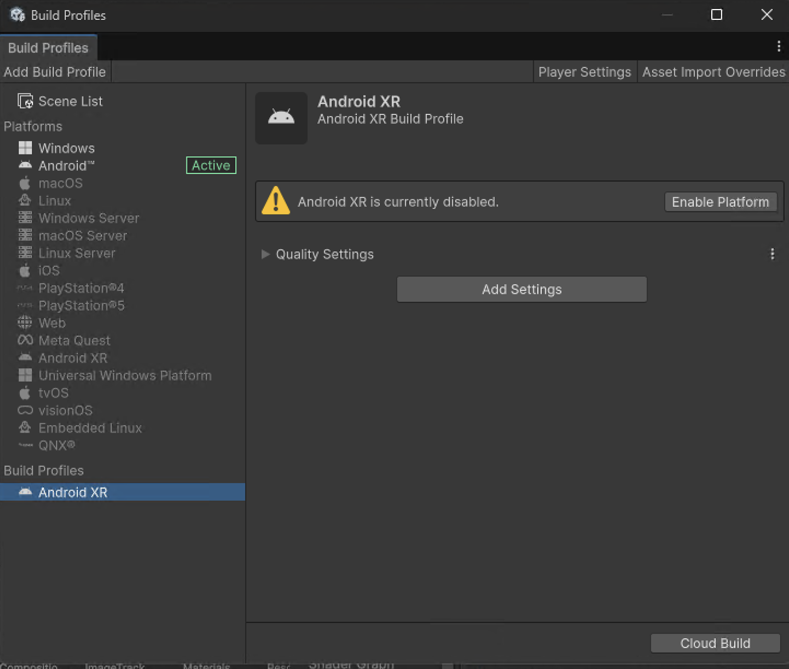

# Android XR Starter Kit for XREAL AURA

[日本語](./README.ja.md)

| scenes 0–2 | scenes 3–5 |
| --- | --- |
| [](https://youtu.be/52wZrd1oV24) | [](https://youtu.be/FxXNzq-5ClU) |
| ▶ [Watch the demo video on YouTube](https://youtu.be/52wZrd1oV24) | ▶ [Watch the demo video on YouTube](https://youtu.be/FxXNzq-5ClU) |

A Unity starter project for building Android XR apps for XREAL AURA. The seven sample scenes show how to render a 3D object, manipulate it with hand tracking, add an interactive UI in 3D space, access the camera image, hide virtual content behind real objects with occlusion, recognize and track an image marker, and place an object at a latitude and longitude with the Geospatial API. The project uses OpenXR, XR Interaction Toolkit, and the Universal Render Pipeline (URP).

## Sample scenes

Open these scenes from `Assets/Scenes` in the `OpenXR-Sample` Unity project.

| Scene | What to try |
| --- | --- |
| [`0-ShowObject`](./OpenXR-Sample/Assets/Scenes/0-ShowObject.unity) | Look for a virtual cube in your surroundings. Start here to check that 3D content appears in the glasses. |
| [`1-ObjectManipulation`](./OpenXR-Sample/Assets/Scenes/1-ObjectManipulation.unity) | Grab the cube with one hand to move and rotate it. Grab it with both hands and bring your hands closer together or farther apart to resize the cube while its position and rotation stay fixed. |
| [`2-UI`](./OpenXR-Sample/Assets/Scenes/2-UI.unity) | Press the button on the world-space canvas to show or hide the cube. Select the text field and type with the spatial keyboard to update the label above the cube. |
| [`3-CameraImage`](./OpenXR-Sample/Assets/Scenes/3-CameraImage.unity) | Grant the camera permission when asked, and the image from the device’s camera appears on a panel in your surroundings. The available cameras and the image size are shown on a label. |
| [`4-Occlusion`](./OpenXR-Sample/Assets/Scenes/4-Occlusion.unity) | Real objects such as walls hide the cube behind them. Move the cube into a wall as in `1-ObjectManipulation`, and the part inside the wall is hidden. Grant the permission Android XR requires for occlusion when asked. |
| [`5-ImageTracking`](./OpenXR-Sample/Assets/Scenes/5-ImageTracking.unity) | Show the marker image (`Assets/ImageTracking/Markers/logo.png`) on a screen, and the cube appears on it and follows its position and orientation. When the marker is lost, the cube stays where it was; you can set it to hide instead in the Inspector. Grant the permission Android XR requires for image tracking when asked. |
| [`6-GeoSpatial`](./OpenXR-Sample/Assets/Scenes/6-GeoSpatial.unity) | A cube appears at the latitude, longitude, and altitude set in the scene. A label in front of you shows the Geospatial state and your latitude, longitude, altitude, and their accuracy. Try it outdoors where buildings are in view, and grant the location permission when asked. This scene needs a Google Cloud project; see [Use the Geospatial API](#use-the-geospatial-api). |

## Sample scripts

The scripts in `Assets/Scripts` were written for this starter kit. You can reuse them as optional helpers in your own app.

| Script | What it does |
| --- | --- |
| [`TwoHandsScaleController.cs`](./OpenXR-Sample/Assets/Scripts/TwoHandsScaleController.cs) | Keeps the cube’s rotation fixed while you resize it with both hands and can also lock its position. |
| [`ToggleCubeVisibility.cs`](./OpenXR-Sample/Assets/Scripts/ToggleCubeVisibility.cs) | Shows or hides the cube when the UI button is pressed. |
| [`ShowInputText.cs`](./OpenXR-Sample/Assets/Scripts/ShowInputText.cs) | Updates the label above the cube as the text field changes. |
| [`CameraAccess.cs`](./OpenXR-Sample/Assets/Scripts/CameraAccess.cs) | Requests the camera permission, lists the available cameras, shows the selected camera’s image on a renderer, and logs the results to an optional label. |
| [`OcclusionEnabler.cs`](./OpenXR-Sample/Assets/Scripts/OcclusionEnabler.cs) | Turns on the AR Occlusion Manager after the user grants the permission Android XR requires for occlusion. |
| [`ImageTrackingEnabler.cs`](./OpenXR-Sample/Assets/Scripts/ImageTrackingEnabler.cs) | Turns on the AR Tracked Image Manager after the user grants the permission Android XR requires for image tracking. |
| [`TrackedImageFollower.cs`](./OpenXR-Sample/Assets/Scripts/TrackedImageFollower.cs) | Makes a target object follow one tracked image, chosen by its name in the reference image library. Add one per marker. |
| [`GeospatialEnabler.cs`](./OpenXR-Sample/Assets/Scripts/GeospatialEnabler.cs) | Turns on the XR Geospatial Manager after the user grants the location permission. |
| [`GeospatialObjectPlacer.cs`](./OpenXR-Sample/Assets/Scripts/GeospatialObjectPlacer.cs) | Places a target object at a latitude, longitude, and altitude. It moves the object only while the accuracy of the device’s location and heading is within the thresholds set in the Inspector. |
| [`GeospatialStatusLabel.cs`](./OpenXR-Sample/Assets/Scripts/GeospatialStatusLabel.cs) | Shows the Geospatial state and the device’s latitude, longitude, altitude, and their accuracy on a label. |

## Requirements

- Unity Hub and Unity 6.3 LTS (`6000.3.7f1`). [Unity Editor download](https://unity.com/releases/editor/whats-new/6000.3.7f1)
- **Android Build Support**, including **Android SDK & NDK Tools** and **OpenJDK**, installed through Unity Hub. [Android XR project setup](https://developer.android.com/develop/xr/unity/setup)
- XREAL AURA glasses, the Compute Puck, and a data-capable USB-C cable for on-device testing.
- A Google Cloud project with the ARCore API turned on, for `6-GeoSpatial` only. See [Use the Geospatial API](#use-the-geospatial-api).

## Open the project

```sh
git clone https://github.com/TakashiYoshinaga/AndroidXR-StarterKit.git
```

Add `AndroidXR-StarterKit/OpenXR-Sample` from disk in Unity Hub and open it. Let Unity finish resolving packages and importing assets on the first launch.

A fresh clone opens on the regular **Android** platform, because the active build profile is saved in the `Library` folder, which isn’t part of the repository. While the project is on that platform, the Unity OpenXR Android XR package turns off some of the Android XR features. After the first launch, switch to the included **Android XR** profile once:

1. Go to **File → Build Profiles** and select **Android XR** under **Build Profiles**.
2. If the profile shows **Android XR is currently disabled**, click **Enable Platform**. Then click **Switch Profile**.

   

3. Go to **Edit → Project Settings → XR Plug-in Management → OpenXR**, open the **Android** tab, and check that **Android XR Support**, **Hand Interaction Profile**, and **Foveated Rendering** are turned on. Turn on any that are off.

You only need to do this again if you delete the `Library` folder.

## Build and run on XREAL AURA

1. In Unity’s **Project** window, open the scene you want to try from `Assets/Scenes`. For your first build, open `0-ShowObject`.
2. Go to **File → Build Profiles** and check that the included **Android XR** profile is active. If it isn’t, follow the steps in [Open the project](#open-the-project).
3. The build scene list starts empty. In the profile, use **Add Settings → Scene List**, then click **Add Open Scenes**. Keep only the scene you want to launch enabled in the list. [Unity scene list guide](https://docs.unity3d.com/6000.3/Documentation/Manual/build-profile-scene-list.html)
4. Enable **USB debugging** in the AURA developer options. Keep the glasses plugged into the Compute Puck and connect your computer to the puck’s charging port with a data-capable USB-C cable. Accept the USB debugging prompt on the device if it appears. [XREAL device setup guide](https://tutorials.xreal.com/docs/aura/developers/getting-started/)
5. Select the device under **Run Device** and click **Build and Run** to build, install, and launch the APK. To try another sample, add its scene to the list, enable only that scene, and build again. [Unity Android build guide](https://docs.unity3d.com/6000.3/Documentation/Manual/android-BuildProcess.html)

## Use the Geospatial API

`6-GeoSpatial` uses the Geospatial API in [Android XR Extensions for Unity](https://github.com/android/android-xr-unity-package), which the project installs as a package. The API finds where the device is with Google’s Visual Positioning System (VPS) through Google Cloud, so set up a Google Cloud project before you build the scene.

1. In the [Google Cloud console](https://console.cloud.google.com/), create or select a project and turn on the [ARCore API](https://console.cloud.google.com/apis/library/arcore.googleapis.com).
2. Go to **APIs & Services → Credentials** and click **Create credentials → API key**. Open the new key, select **Restrict key** under **API restrictions**, and choose **ARCore API**. To also limit the key to this app, select **Android apps** under **Application restrictions** and add the package name `com.UnityTechnologies.com.unity.template.urpblank` with the SHA-1 fingerprint of the certificate that signs your build. Development builds are signed with the Android debug keystore (`.android/debug.keystore` in your home folder).
3. In Unity, go to **Edit → Project Settings → XR Plug-in Management → OpenXR**, open the **Android** tab, and click the gear icon next to **Android XR: Google Cloud**. Set **Authentication Strategy** to **API Key** and paste the key into **Credential**. The default, **Keyless**, needs an OAuth client in Google Cloud instead of a key.
4. Open `6-GeoSpatial` and select **GeospatialController**. In **Geospatial Object Placer**, set **Latitude** and **Longitude** to where you want the cube. **Altitude** is the height above the WGS84 ellipsoid, not above sea level: stand near the spot, read your altitude on the label, and enter a value about 1.5 m lower to put the cube near the ground.
5. Build and run the scene as described in [Build and run on XREAL AURA](#build-and-run-on-xreal-aura), and try it outdoors where buildings and streets are in view. The label shows **Geospatial: Running** and the accuracy of your location.

The cube moves only while the horizontal accuracy (H) and heading accuracy (Yaw) on the label are within **Max Horizontal Accuracy** and **Max Yaw Accuracy** in **Geospatial Object Placer**. Otherwise it stays where it was. If the cube never appears, compare these values with the label and raise the thresholds. VPS works where Google Street View imagery is available; elsewhere, the accuracy may not get good enough.

**Keep your API key out of the repository.** Unity saves the key in `OpenXR-Sample/Assets/XR/Settings/OpenXR Package Settings.asset`. Don’t commit or share the file while it contains the key.

## License

The original project code is released under the [MIT License](./LICENSE).

Unity sample assets are included under `OpenXR-Sample/Assets/Samples`. See the respective package terms for [XR Interaction Toolkit](https://unity.com/legal/licenses/unity-companion-license) and [XR Hands](https://unity.com/legal/licenses/unity-package-distribution-license).

The occlusion shaders in `OpenXR-Sample/Assets/Shaders/Occlusion` are copied unmodified from [AR Foundation Samples](https://github.com/Unity-Technologies/arfoundation-samples) (branch `6.6`) by Unity Technologies, and are licensed under the [Unity Companion License](https://unity.com/legal/licenses/unity-companion-license). See [`LICENSE.md`](./OpenXR-Sample/Assets/Shaders/Occlusion/LICENSE.md) in that folder.
